# IBM Bob on RHOAI

End-to-end guide for deploying [IBM Bob](https://bob.ibm.com/docs/ide/enterprise/on-premises/installation/install) on OpenShift with a self-hosted Nemotron model served via RHOAI Models-as-a-Service (MaaS).

## Prerequisites

Below are the platform components that were used to develop this guide. 

| Component | Version |
|---|---|
| Red Hat OpenShift Container Platform | 4.22.11 (AWS) |
| Red Hat OpenShift AI | 3.5.0 (vLLM v0.24.0) |
| Red Hat Connectivity Link | 1.4.3 |

**Storage:** `gp3-csi` (Block RWO), `efs` (FS RWX)  

**GPU:** 4× NVIDIA H100 80GB VRAM (for Nemotron 3.5 Super VL 120B BF16)

**Deploying IBM Bob v2.0.0**

> Note: The GPU requirement will change depending on the model you choose to back IBM Bob with. The list of supported models can be found in the [IBM Bob documentation](https://bob.ibm.com/docs/ide/enterprise/on-premises/model-gateway/supported-models#air-gapped-models).

## Automated Model Deployment

A `kustomization.yaml` has been provided for you in `./deploy-model`, that will automatically deploy a single replica of the [Nemotron 3.5 Super VL 120B BF16](https://huggingface.co/nvidia/NVIDIA-Nemotron-3.5-Super-VL-120B-A12B-BF16) model. It is presumed you are using 4xH100 GPU nodes. Manifests may need to be edited if this is not the case.

```bash
$ cp deploy-model/hf-token.env.example deploy-model/hf-token.env

# Edit below to speed up the model weight download from HuggingFace.
$ vi deploy-model/hf-token.env

$ oc apply -k deploy-model/

namespace/bob created
secret/hf-token created
persistentvolumeclaim/nemotron-super-vl created
job.batch/nemotron-super-vl-loader created
llminferenceservice.serving.kserve.io/nemotron-super-vl created
```

This will do the following:

* Download the weights into a PVC called "nemotron-super-vl". This job can take ~15 minutes, depending on network speed.
* Deploy an `LLMInferenceService` object. This will deploy the model and make it available as an AI Asset Endpoint / part of RHOAI's MaaS.

Once this is done, you can continue from [MaaS Configuration](#2-maas-configuration)

## Manual Model Deployment

> Note: MaaS was configured on the cluster using this [automated setup script](https://rh-aiservices-bu.github.io/rhoai-maas-guide/modules/main/quick-start.html).

The model deployed for this guide is [NVIDIA-Nemotron-3.5-Super-VL-120B-A12B-BF16](https://huggingface.co/nvidia/NVIDIA-Nemotron-3.5-Super-VL-120B-A12B-BF16). This is one of the models supported by IBM Bob, though [others are available](https://bob.ibm.com/docs/ide/enterprise/on-premises/model-gateway/supported-models#air-gapped-models). 

This model will be deployed on Red Hat OpenShift AI >=V3.5, with llm-d, as this is what's required by RHOAI Models-as-a-Service (MaaS).

#### Steps

**1. Create and label the `bob` namespace**

This will be the namespace where we are deploying the model that IBM-Bob utilises.

```sh
oc new-project bob
oc label namespace bob maas.opendatahub.io/gateway-access="true"
```

**2. Pre-load model weights into a PVC**

Pre-loading reduces model startup time. See [`scripts/load-model-to-pvc.sh`](scripts/load-model-to-pvc.sh) for full usage.

```sh
./scripts/load-model-to-pvc.sh \
  --namespace bob \
  -m hf://nvidia/NVIDIA-Nemotron-3.5-Super-VL-120B-A12B-BF16 \
  -s 200Gi \
  -t ${HF_TOKEN} \
  -p nemotron-35-super-vl \
  -g -N ${GPU_WORKER_NODE}
```

**3. Deploy via the RHOAI UI**

In **AI Hub** → **Models** → **Deployments**, click "Deploy model".

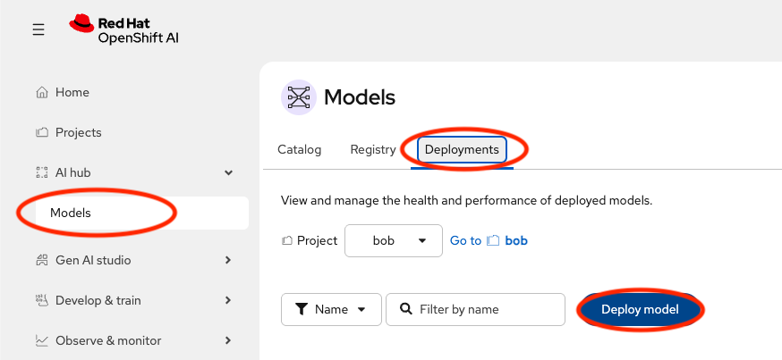

Fill out the deployment details as shown. If you loaded the model into a pvc, you can reference that as a URI location.

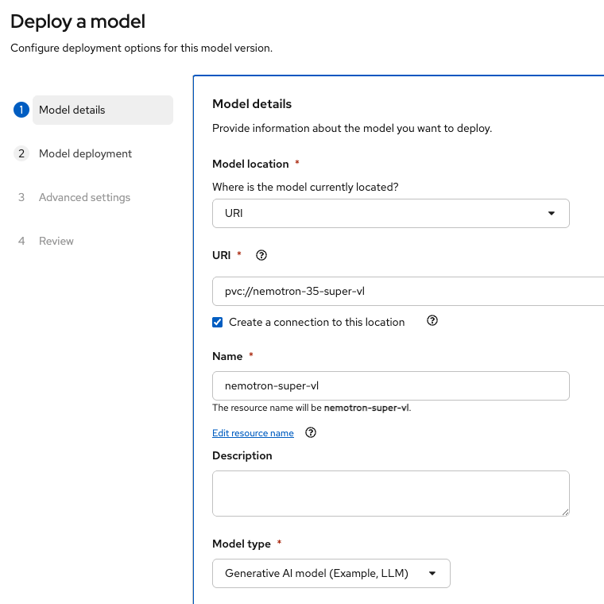

Ensure the model is deployed as an LLM Inference service with llm-d.

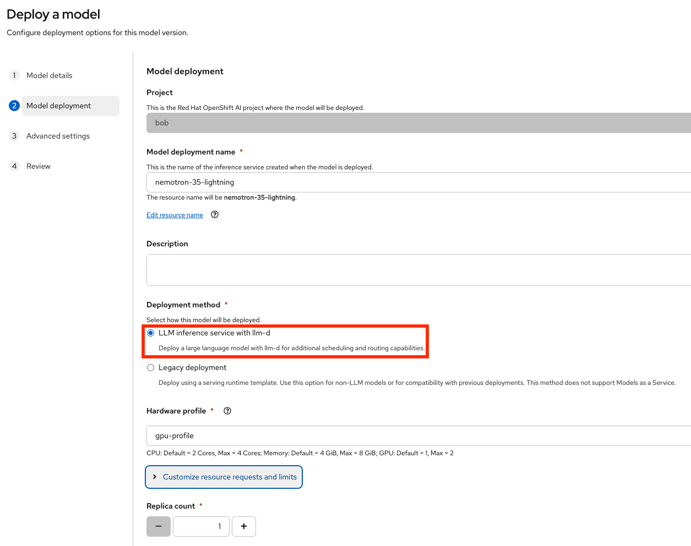

Ensure that **"Add as AI asset endpoint"** and **"Publish as MaaS"** are checked.

Also, add the following vLLM runtime arguments during deployment:

```
--tensor-parallel-size=4
--reasoning-parser=nemotron_v3
--tool-call-parser=qwen3_coder
--enable-auto-tool-choice
```

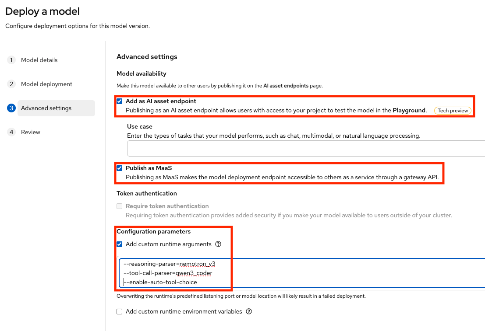

Click **Next** → **Deploy Model**.

**4. Confirm pods are running**

```sh
oc get pods -n bob

NAME                                                         READY   STATUS      RESTARTS   AGE
nemotron-super-vl-kserve-549fb6664f-99df8                    1/1     Running     0          24m
nemotron-super-vl-kserve-router-scheduler-85c9cb48bb-fnsvf   1/1     Running     0          24m
```

> **Tainted GPU nodes:** Your pods may fail to schedule if they're tainted. In that case, add a toleration to the `LLMInferenceService` CR:
>
> ```sh
> oc edit llmisvc nemotron-super-vl -n bob
> ```
>
> ```yaml
> spec:
>   template:
>     tolerations:
>     - effect: NoSchedule
>       key: nvidia.com/gpu
>       value: NVIDIA-H100-PRIVAYE
> ```

---

### 2. MaaS Configuration

With **"Add as AI Asset Endpoint"** and **"Publish to MaaS"** checked, the model will then appear in the AI asset endpoints page.

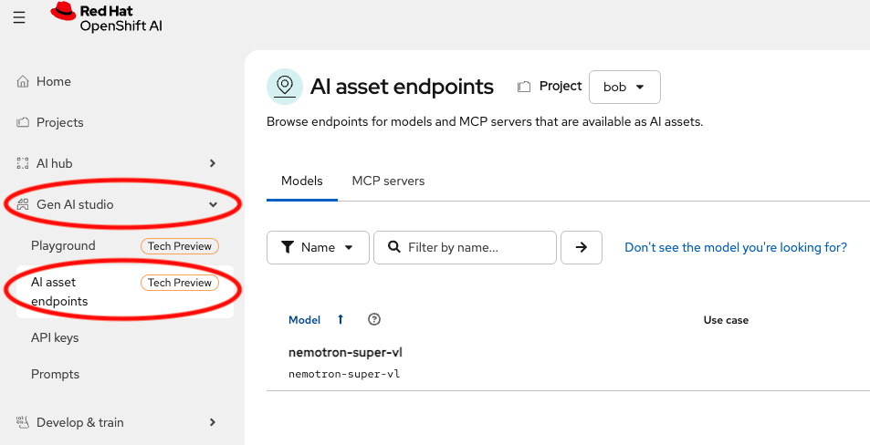

**Create a subscription**

Go to **Settings > MaaS Governance > Subscriptions** → **Create Subscription**.

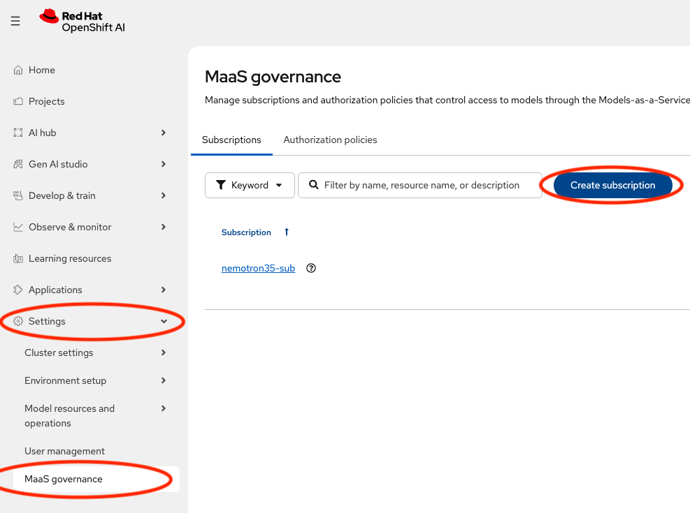

- Name the subscription (e.g. `nemotron-super-vl-sub`)
- Set a priority (irrelevant if this is your only subscription)
- In the **Groups** field, type `system:authenticated` (won't appear in the dropdown — this grants access to any OpenShift-authenticated user)

- Click **Add models** and select `nemotron-super-vl`.

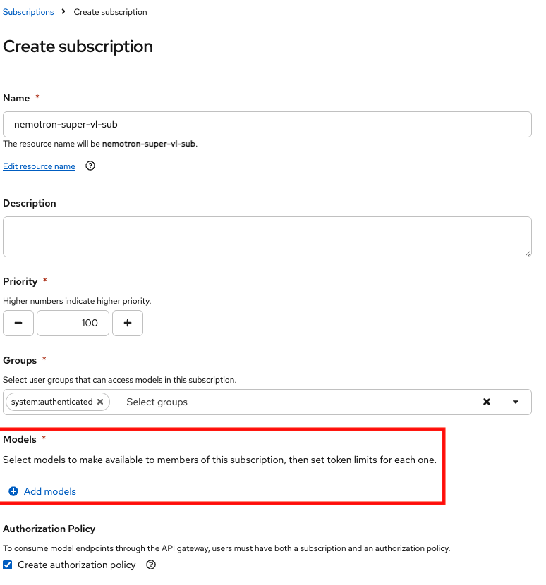

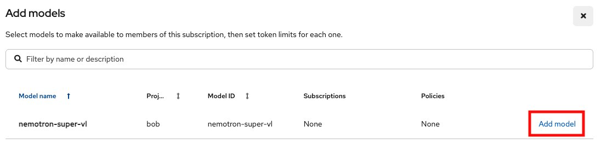

- Set the token rate limit to `9999` tokens/second (effectively unlimited — a value is required).
- Click **"Save"**

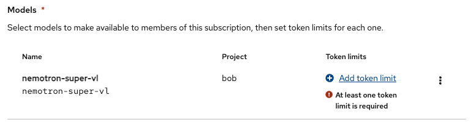

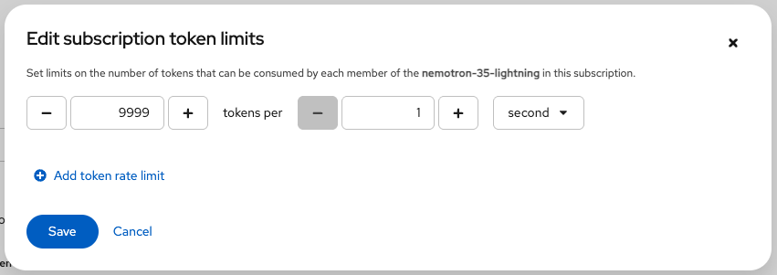

Keep **"Create authorization policy"** checked and click **Create Subscription**.

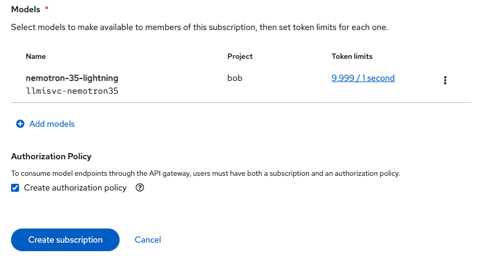

**Generate an API key**

Go to **Gen AI Studio > API Keys** → **Create API Key**.

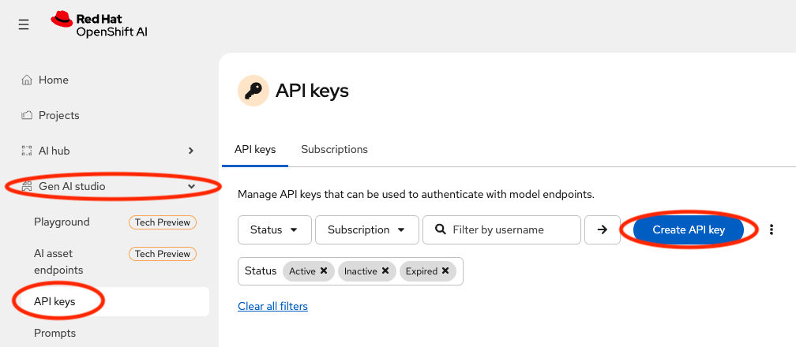

Select the subscription you just created. Set an expiry (maximum 90 days).

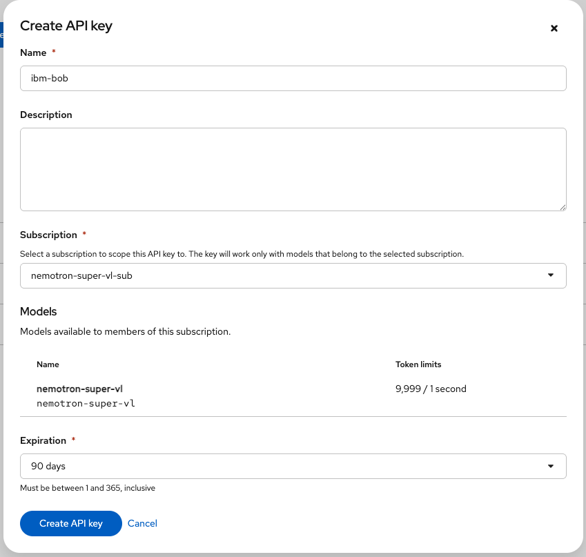

**Save the key immediately — it cannot be retrieved after closing this screen.**

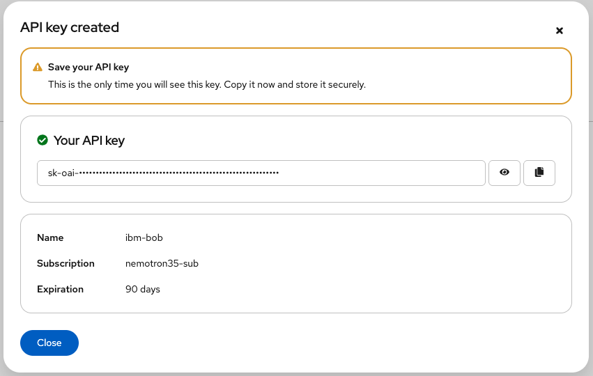

#### Verification

Navigate to **Gen AI Studio > AI asset endpoints**. You'll see two entries for your model.

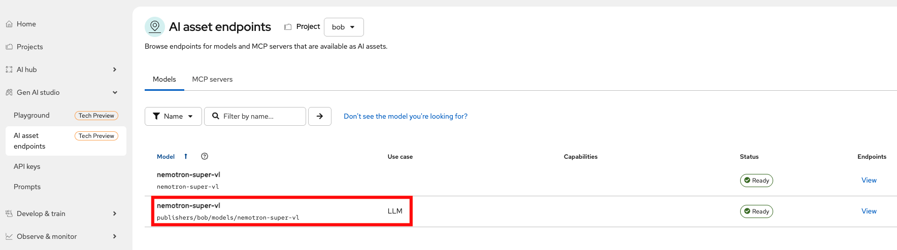

The entry with **LLM** as the use case contains the information needed:
- **Model ID** — the value under "Model name" (e.g. `publishers/bob/models/llmisvc-nemotron35`)
- **Endpoint** — click **View** in the Endpoints column to retrieve the external API endpoint

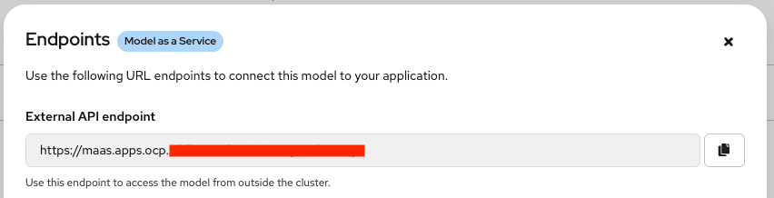

Test inference using [`scripts/test-maas-endpoint.sh`](scripts/test-maas-endpoint.sh) — update the `TOKEN`, `ENDPOINT`, and `MODEL` variables at the top of the script before running.

---

### 3. IBM Bob Deployment

> **Docs:** [IBM Bob — Installation](https://bob.ibm.com/docs/ide/enterprise/on-premises/installation/install)

> **Note:** You will need an entitlement key for access to IBM Container Registry images.

#### Steps

**1. Download and extract the release bundle**

```sh
mkdir ibm-bob-github && cd ibm-bob-github
wget https://github.com/IBM/ibm-bob/releases/download/v2.0.0/ibm-bob-install-20260924-163534.tgz
tar xvf ibm-bob-install-20260924-163534.tgz
```

**2. Create `config.yaml`**

Copy `config-template.yaml` to `config.yaml` and fill it in. See [`manifests/config.yaml`](manifests/config.yaml) for the example used here.

- `INFERENCE_API_KEY` should be the MaaS API key generated in [Section 2](#2-maas-configuration).

**3. Install**

```sh
oc login   # log in to your OpenShift cluster first

./bobctl generate-cluster-resources
./bobctl install --registry-creds cp:<ENTITLEMENT_KEY> --accept-license
```

### Verify

```sh
oc get pods -n ibm-bob

NAME                                           READY   STATUS    RESTARTS   AGE
bob-admin-75d8f7c56c-hz822                     1/1     Running   1          23h
bob-admin-redis-haproxy-6c7b7fb8c7-gks4k       1/1     Running   1          23h
bob-admin-redis-server-0                       2/2     Running   2          25h
...

oc get bob -n ibm-bob

NAME     READY   MESSAGE                         AGE
bob-cr   True    Last reconciliation succeeded   25h
```

---

### 4. RHBK Configuration

IBM Bob ships with Red Hat Build of Keycloak (RHBK) for authentication, including pre-made groups and an admin user.

> **Docs:** [IBM Bob — User Management](https://bob.ibm.com/docs/ide/enterprise/on-premises/user-management#managing-direct-keycloak-users)

#### Steps

**1. Find the Keycloak route**

```sh
oc get routes --selector app.kubernetes.io/instance=bob-keycloak -n ibm-bob
```

**2. Log in with the initial admin credentials**

The temporary credentials are in the `bob-keycloak-initial-admin` secret in the `ibm-bob` namespace.

**3. Locate the admin user**

In the **bob** realm, go to **Groups**.

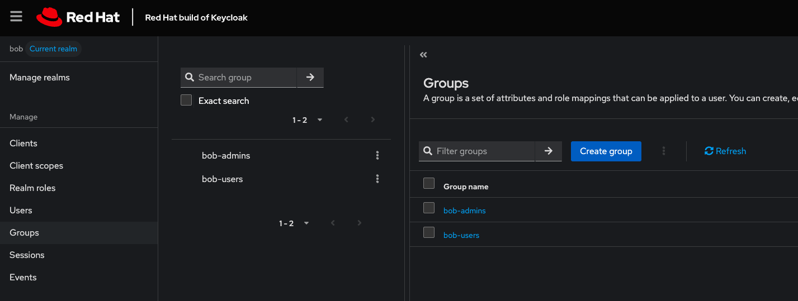

Open the `bob-admins` group to find the pre-made admin user.

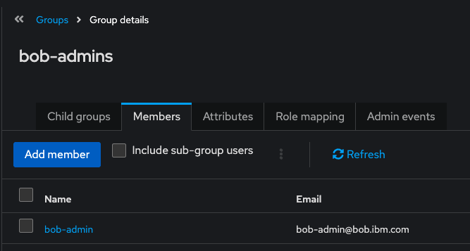

Note down the email address. Click the user, go to **Credentials** → **Reset Password**, and set a known password.

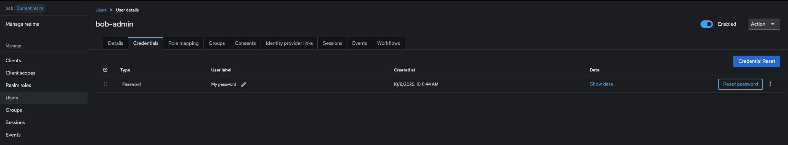

#### Verify

Retrieve the IBM Bob UI route — use the one whose hostname does **not** start with `api.bob`:

```sh
oc get routes -n ibm-bob --selector app.kubernetes.io/component=bob-gateway

NAME                HOST/PORT
bob-gateway-9zrd6   bob.ibm-bob.apps.<cluster>
bob-gateway-swkbq   api.bob.ibm-bob.apps.<cluster>   ← not this one
```

Log in with the Keycloak email and password.

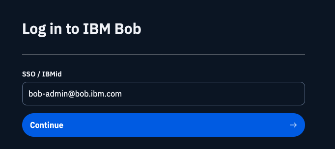
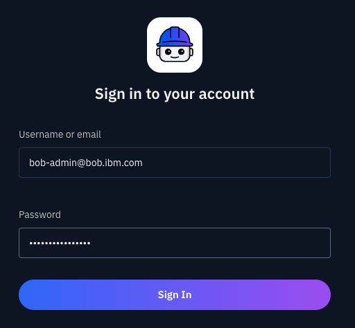

---

### 5. Model Configuration

> **Docs:** [IBM Bob — Model Gateway Configuration](https://bob.ibm.com/docs/ide/enterprise/on-premises/model-gateway/configuration)

From the IBM Bob release directory, copy `config-model-gateway-template.yaml` to a new file (e.g. `my-model-config.yaml`) and configure the active model. See [`manifests/model-gateway-config.yaml`](manifests/model-gateway-config.yaml) for a full example.

The key section:

```yaml
models:
  - &chat_llm
    model_name: premium-ide
    openai_compatible:
      model: publishers/bob/models/llmisvc-nemotron35    # Model ID from MaaS
      base_url: https://maas.apps.<cluster>              # MaaS gateway URL
      api_key: env.INFERENCE_API_KEY                     # References the secret in config.yaml
    model_info:
      exposed: true
      provider: nvidia
      family: nemotron
      version: "3-ultra"        # Must be "3-ultra"
      max_input_tokens: 200000
      max_output_tokens: 56000
      supports_vision: false
      mode: chat
```

Apply the configuration:

```sh
./bobctl update-model-config --model-config my-model-config.yaml
```

---

### 6. Consuming IBM Bob

> **Docs:** [IBM Bob — Accessing On-Premises](https://bob.ibm.com/docs/ide/enterprise/on-premises/accessing)

### Trust the Certificate

Follow the [IBM docs](https://bob.ibm.com/docs/ide/enterprise/on-premises/accessing#trust-the-ca-certificate). Retrieve the CA cert from the cluster:

```sh
oc extract -n ibm-bob secret/bob-external-tls --to=. --keys=ca.crt
```

### Bob Shell

Install the [Bob Shell CLI](https://bob.ibm.com/docs/shell/getting-started/install-and-setup), then configure the gateway URLs using the routes from step 4:

```sh
oc get routes -n ibm-bob --selector app.kubernetes.io/component=bob-gateway
```

- `BOB_GATEWAY_URL` → the `api.bob.*` route
- `BOB_WEB_LOGIN_URL` → the non-api route

Set these as environment variables or pass them as CLI options per the [instructions](https://bob.ibm.com/docs/ide/enterprise/on-premises/accessing#bob-shell).

Running `bob` will open the web login page — use your Keycloak credentials.

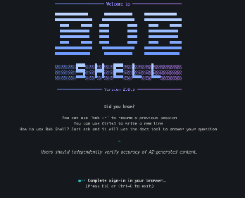
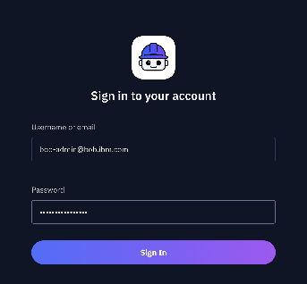

Finally you'll have a Bob Shell connected to your RHOAI hosted model! 🎉

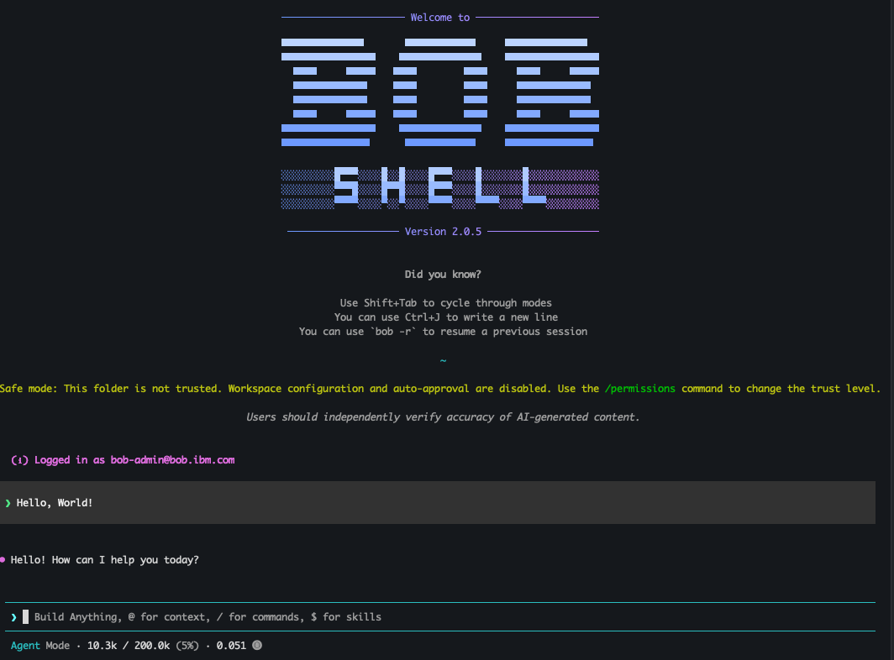

#### Bob IDE

> The IDE picks up settings populated by a successful Bob Shell login, so complete the Shell setup first.

Install the [IBM Bob IDE binary](https://bob.ibm.com/docs/ide/getting-started/install). Once installed:

1. Open **Bob Settings** (bottom right of the application)

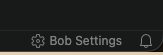

2. Open `settings.json`

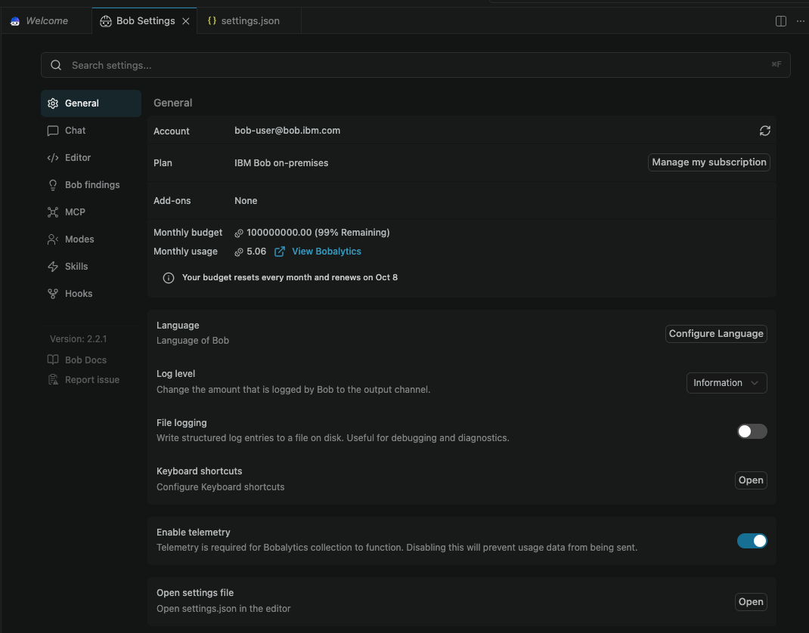

3. Confirm `gateway_url` is present

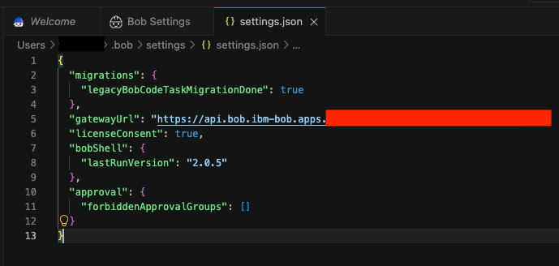

After trusting the workspace folder, the Bob chat interface will appear. 🎉

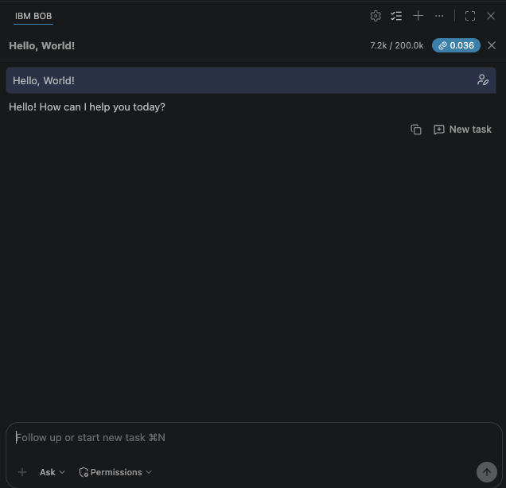

## Troubleshooting

### LLMInferenceService Startup Probe

When deploying large models (i.e. >70B parameters), the model loading time can be so long that the startup probe will restart the pod too soon. If you notice this, you can extend the startup probe in the `LLMInferenceService` object via:

```yaml
spec:
  template:
    containers:
      - name: 
        ...
        startupProbe:
          failureThreshold: 120 # Default: 60; 120 * 10s = 20 minutes
          periodSeconds: 10     # Default: 10
```

### load-model-to-pvc.sh XET Models

If your OpenShift cluster is behind a corporate VPN or proxy, there may not be rules setup to allow for HuggingFaces' XET protocol. You can disable this transfer method by setting `--disable-xet` when calling `load-model-to-pvc.sh`.

### vLLM MM processor cache crash

Occasionally, vLLM's 'profile_run()' can crash with "ValueError: value too large". See [vLLM#52835](https://github.com/vllm-project/vllm/issues/52835) for more information as to why this happens.

To fix this, you can either [increase the cache size](https://docs.vllm.ai/en/stable/cli/bench/mm_processor/#-mm-processor-cache-gb), or you can [limit what modality is allowed](https://docs.vllm.ai/en/stable/cli/bench/mm_processor/#-limit-mm-per-prompt). These are both applied via vLLM runtime arguments, and is done when [deploying the model via the UI](./README.md#1-model-deployment-rhoai)).

```bash
--mm-processor-cache-gb=24 # This ill increase the memory requirement of the model.
or
--limit-mm-per-prompt='{"video":0}'  # This will reject all video inputs in your prompts. 
```
